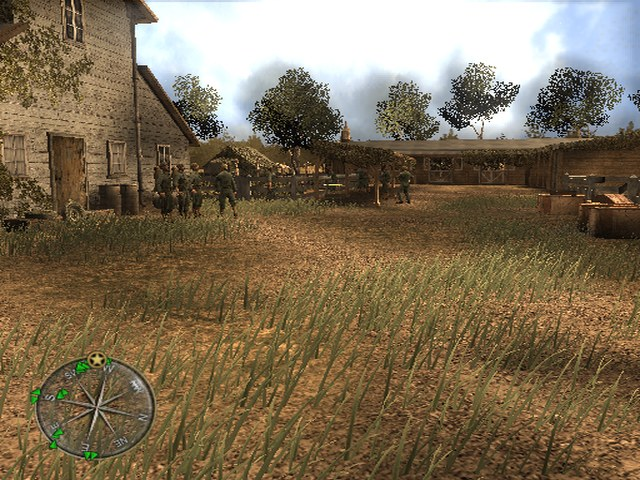
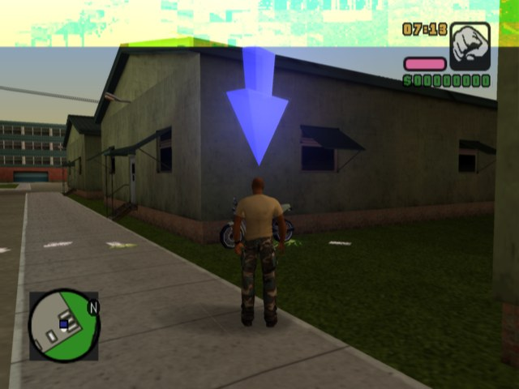
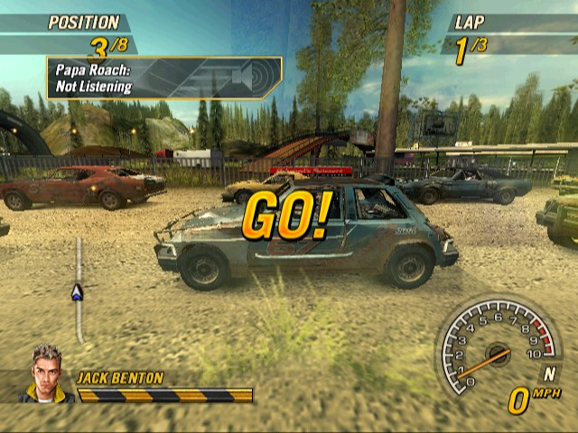
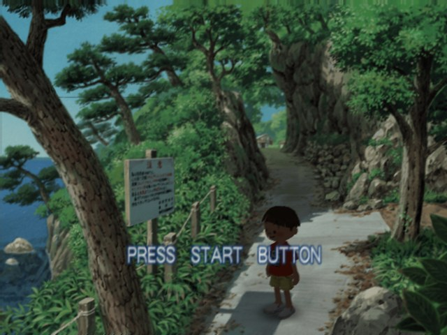
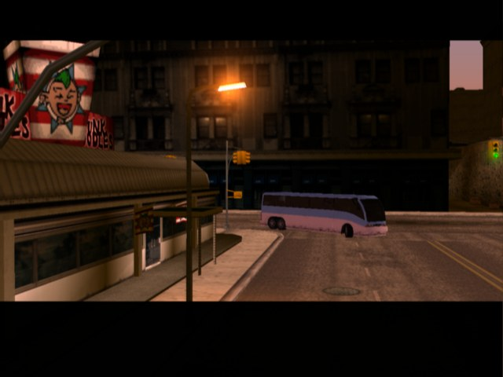
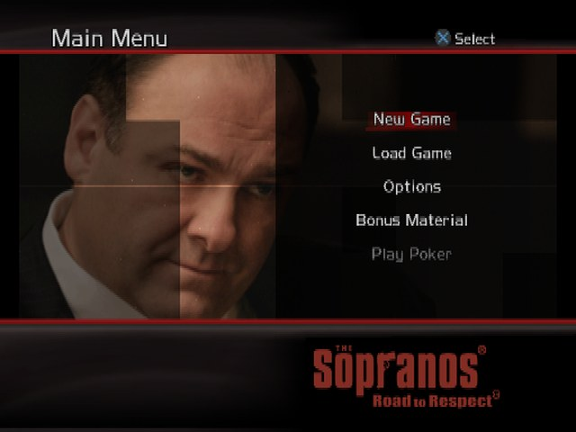

## PS2Recomp: PlayStation 2 Static Recompiler (fork with game ports)

Fork of [ran-j/PS2Recomp](https://github.com/ran-j/PS2Recomp) with a faster, more complete runtime, a set of game
profiles in [`games/`](games/) and a launcher that builds and starts them from **your own disc**. No game content
(disc image, executable, data or generated code) is in this repository.

## How to play a game

Windows 10/11 x64. About 20-40 GB free and one to several hours for the first build of a game.

1. Get this repository, either way:
   - `git clone --recurse-submodules https://github.com/batatinhafcbatatinha-pixel/PS2Recomp.git`, or
   - **Code > Download ZIP** and unpack it, or
   - only [`Launcher.exe`](https://github.com/batatinhafcbatatinha-pixel/port-installer/releases/latest/download/Launcher.exe):
     run it, choose a folder, and it downloads this repository there.
2. Run **`Launcher.cmd`** (it downloads `Launcher.exe` from the
   [port-installer releases](https://github.com/batatinhafcbatatinha-pixel/port-installer/releases) the first time).
3. Click **CHOOSE ISO...** and pick your disc image (`.iso`). The game is recognised from the disc.
4. Confirm **Install**. The launcher installs what is missing (Python, Visual Studio C++ Build Tools, CMake, Ninja,
   Ghidra + the PS2 extension, Java), copies and checks the game files, translates the game code and compiles it.
   Stopping is safe: finished steps are skipped next time. Log: **Install** tab and `games/<game>/setup-log.txt`.
5. **PLAY**. **PC settings** in the launcher, or **F1** (Back+Start on a controller) in the game: display mode,
   resolution, frame limit, V-Sync, graphics card, controls, language, volume.

| Game | Disc | State |
| --- | --- | --- |
| Ben 10: Alien Force | USA (SLUS-21815) | reaches gameplay |
| Boku no Natsuyasumi 2 | Japan (SCPS-15026) | title, demo and New Game |
| Call of Duty: World at War - Final Fronts | USA/Canada (SLUS-21746) | reaches the first mission |
| FlatOut 2 | USA (SLUS-21251) | reaches races |
| Grand Theft Auto: Liberty City Stories | USA v1.01 (SLUS-21423) | reaches the first mission |
| Grand Theft Auto: Vice City Stories | USA (SLUS-21590) | reaches gameplay |
| Gran Turismo 4 | USA v2.00 (SCUS-97328) | not playable yet |
| MotorStorm: Arctic Edge | USA (SCUS-97654) | not playable yet |
| The Sopranos: Road to Respect | USA v1.01 (SLUS-21388) | not playable yet |

These discs have a profile (checked by SHA-256, see each `games/<game>/installer.json`). Details per game:
[`games/`](games/README.md). Saves go to `mc0/` and `mc1/` in the game folder.

### Any other game

Choose any other PlayStation 2 disc the same way: the launcher offers to build it with the generic pipeline
([`tools/ps2port`](tools/ps2port/README.md)), the same steps for every game, no game-specific code. It may not work
yet, or stop somewhere; while it runs, code the analysis missed is translated and compiled on the spot (a short
pause the first time) and goes into the next build. These ports live in `.local/ports/<serial>/`.

## Differences from upstream

- `games/`: nine game profiles (recompiler config, native handlers, build and play scripts)
- `tools/ps2port`: one pipeline for any game (Ghidra export, gap functions by general rules, SDK functions by learned signatures, IOP modules incl. IOPRP images, VU1 from captures, RAM-aware build)
- missing guest code recorded while playing (`PS2X_OBSERVE_DIR`) and translated + compiled at run time (`ps2_hot.cpp`)
- IOP-side client services shared by all games (loadfile, libfs, directory listing, pad2)
- runtime arena below the executable by default (no clash with a stack or heap at the top of RAM)
- launcher + one-click install/build/play (`Launcher.cmd`, [port-installer](https://github.com/batatinhafcbatatinha-pixel/port-installer) submodule in `tools/port-installer`)
- runs from the extracted disc folder (no ISO at run time), sector layout kept
- hardware GS renderer (OpenGL 4.6): internal resolution, GPU detile and scanout, mipmaps, shared-texture present
- GS frontend, VIF1/VU1/GIF on their own threads; flips queued behind pending work
- native VU1 blocks (ahead-of-time), VU1 Q/P/FSAND timing
- PATH3 gating and DMA chain fixes (no cut at 4096 tags), exact Gouraud in the software GS
- IOP modules (IRX) recompiled statically (AOT, HI16/LO16 pairing), IOP kernel, module loader, RPC, SIF and timer fixes
- native SPU2 audio, MPEG video, CDVD and memory card fixes
- OHCI USB host only with `PS2X_IOP_USB=1`
- wall-clock EE timing, scheduler and thread fixes, per-call runtime costs removed
- in-game PC menu (F1): display mode, resolution, refresh rate, V-Sync, frame limit, filter, aspect, FXAA, GPU, FPS counter, language, volume
- SDL3 input: every pad, keyboard and mouse, modern layout, vibration
- profiler and timeline (`PS2X_PROFILE_AT`), GS trace
- macOS build (arm64/x86_64, software GS, experimental) and its CI job

## Building

Windows: Visual Studio 2022 (or Build Tools) with the C++ workload and Windows SDK, CMake 3.25+, Ninja, Python 3.11+.
Game profiles also need Ghidra 12.1.4 with [ghidra-emotionengine-reloaded](https://github.com/chaoticgd/ghidra-emotionengine-reloaded)
and Java 21 (the launcher puts all of them in `.local/tools`).

Tools and runtime (from a "x64 Native Tools" prompt):

```bat
git clone --recurse-submodules https://github.com/batatinhafcbatatinha-pixel/PS2Recomp.git
cd PS2Recomp
cmake -S . -B out/build -G Ninja -DCMAKE_BUILD_TYPE=Release
cmake --build out/build
```

One game, without the launcher (same steps it runs; `-Source` is your disc image):

```bat
powershell -ExecutionPolicy Bypass -File tools\port-installer\setup\setup.ps1 -GameDir games\gta-lcs -ToolsDir .local\tools -Source "D:\ISO\your-disc.iso"
```

Or step by step inside `games/<game>/`: the `steps` of its `setup.json` in order (Ghidra export, `build-recompiler.cmd`,
`python scripts/prepare_game_code.py`, `build-native.cmd`), then `Play-<game>.cmd`. Linux/macOS: `build-linux.sh` /
`build-macos.sh` in the games that have them.

The launcher itself is built from [port-installer](https://github.com/batatinhafcbatatinha-pixel/port-installer)
(`dotnet build launcher/Launcher.csproj`).

## Screenshots

The furthest point each game has reached in the native builds so far, captured from the ports while they run.

<table>
<tr>
<td align="center" valign="top" width="50%">
<br>
<b>Call of Duty: World at War - Final Fronts</b><br>
<sub>First mission</sub>
</td>
<td align="center" valign="top" width="50%">
<br>
<b>Grand Theft Auto: Vice City Stories</b><br>
<sub>Gameplay</sub>
</td>
</tr>
<tr>
<td align="center" valign="top" width="50%">
<br>
<b>FlatOut 2</b><br>
<sub>Race start</sub>
</td>
<td align="center" valign="top" width="50%">
<br>
<b>Boku no Natsuyasumi 2</b><br>
<sub>Demo gameplay (built with no game-specific code)</sub>
</td>
</tr>
<tr>
<td align="center" valign="top" width="50%">
<br>
<b>Grand Theft Auto: Liberty City Stories</b><br>
<sub>City behind the title screen (built with no game-specific fixes)</sub>
</td>
<td align="center" valign="top" width="50%">
<br>
<b>The Sopranos: Road to Respect</b><br>
<sub>Main menu</sub>
</td>
</tr>
<tr>
<td align="center" colspan="2">
<sub>Ben 10: Alien Force screenshot is coming. Gran Turismo 4 and MotorStorm: Arctic Edge do not show a picture yet.</sub>
</td>
</tr>
</table>

The original project's documentation is in its [wiki](https://github.com/ran-j/PS2Recomp/wiki).
