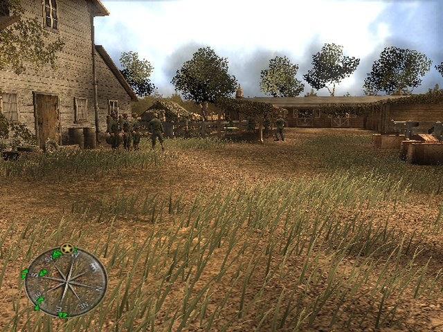
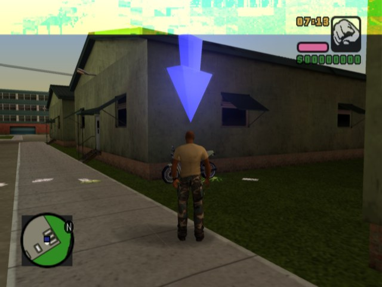
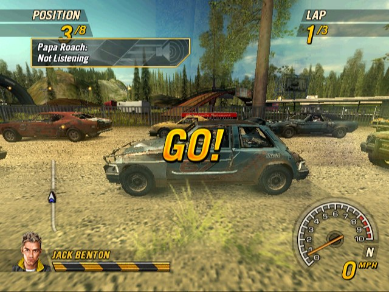
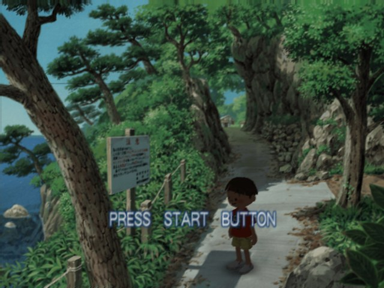
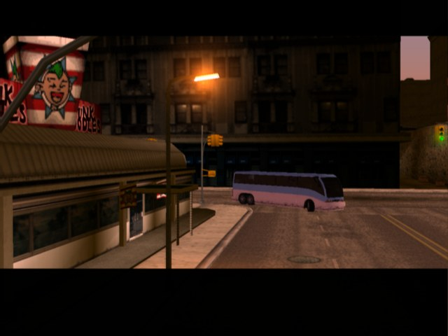
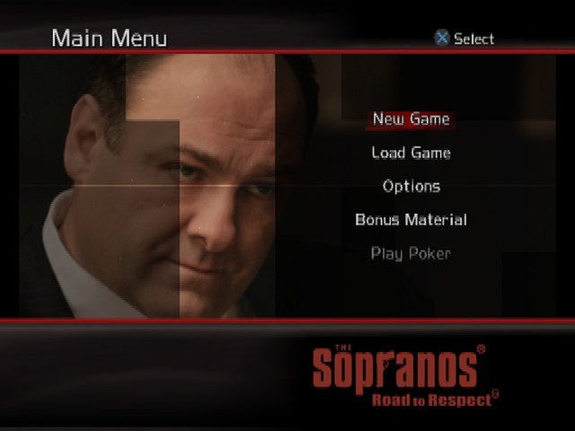

## PS2Recomp: PlayStation 2 Static Recompiler (fork with game ports)

**Download:** [Windows](https://github.com/batatinhafcbatatinha-pixel/PS2Recomp/releases/latest/download/PS2Recomp-windows.zip) (source + `Launcher.exe`: unzip, open `Launcher.exe`) · [Linux](https://github.com/batatinhafcbatatinha-pixel/PS2Recomp/releases/latest/download/PS2Recomp-linux.zip) · [macOS](https://github.com/batatinhafcbatatinha-pixel/PS2Recomp/releases/latest/download/PS2Recomp-macos.zip) (source only, LF line endings, no launcher: build with the games' `build-linux.sh` / `build-macos.sh`).

Fork of [ran-j/PS2Recomp](https://github.com/ran-j/PS2Recomp) with a faster, more complete runtime, a set of game
profiles in [`games/`](games/) and a launcher that builds and starts them from **your own disc**. No game content
(disc image, executable, data or generated code) is in this repository.

## How to play a game

Windows 10/11 x64. About 20-40 GB free and one to several hours for the first build of a game.

1. Get this repository, either way:
   - `git clone --recurse-submodules https://github.com/batatinhafcbatatinha-pixel/PS2Recomp.git`, or
   - **Code > Download ZIP** and unpack it, or
   - only [`Launcher.exe`](https://github.com/batatinhafcbatatinha-pixel/port-installer/releases/latest/download/Launcher.exe):
     run it, choose a folder, and it downloads this repository there.
2. Run **`Launcher.cmd`** (it downloads `Launcher.exe` from the
   [port-installer releases](https://github.com/batatinhafcbatatinha-pixel/port-installer/releases) the first time).
3. Click **CHOOSE ISO...** and pick your disc image (`.iso`). The game is recognised from the disc.
4. Confirm **Install**. The launcher installs what is missing (Python, Visual Studio C++ Build Tools, CMake, Ninja,
   Ghidra + the PS2 extension, Java), copies and checks the game files, translates the game code and compiles it.
   Stopping is safe: finished steps are skipped next time. Log: **Install** tab and `games/<game>/setup-log.txt`.
5. **PLAY**. **PC settings** in the launcher, or **F1** (Back+Start on a controller) in the game: display mode,
   resolution, frame limit, V-Sync, graphics card, controls, language, volume.

## Screenshots

The furthest point each game has reached in the native builds so far, captured from the ports while they run.

<table>
<tr>
<td align="center" valign="top" width="50%">
 
<b>Call of Duty: World at War - Final Fronts</b> 
First mission
</td>
<td align="center" valign="top" width="50%">
 
<b>Grand Theft Auto: Vice City Stories</b> 
Gameplay
</td>
</tr>
<tr>
<td align="center" valign="top" width="50%">
 
<b>FlatOut 2</b> 
Race start
</td>
<td align="center" valign="top" width="50%">
 
<b>Boku no Natsuyasumi 2</b> 
Demo gameplay (built with no game-specific code)
</td>
</tr>
<tr>
<td align="center" valign="top" width="50%">
 
<b>Grand Theft Auto: Liberty City Stories</b> 
City behind the title screen (built with no game-specific fixes)
</td>
<td align="center" valign="top" width="50%">
 
<b>The Sopranos: Road to Respect</b> 
Main menu
</td>
</tr>
<tr>
<td align="center" colspan="2">
Ben 10: Alien Force screenshot is coming. Gran Turismo 4 and MotorStorm: Arctic Edge do not show a picture yet.
</td>
</tr>
</table>

## More

Differences from upstream and building: [docs/DEVELOPING.md](docs/DEVELOPING.md).

The original project's documentation is in its [wiki](https://github.com/ran-j/PS2Recomp/wiki).
